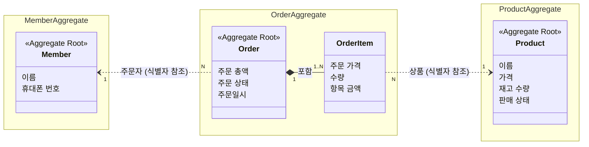

# 상품·주문 도메인

용어는 [용어사전](glossary.md)을 따른다.

## 도메인 정의

### 관계와 애그리거트



| 애그리거트 | 루트 | 구성원 | 설명 |
|---|---|---|---|
| 회원 | Member | - | |
| 상품 | Product | - | 재고는 상품 애그리거트 안에서만 바뀐다 |
| 주문 | Order | OrderItem | 주문항목은 주문 루트를 통해서만 생성·변경된다 |

- 애그리거트는 함께 생성·변경·삭제되는 단위다. 외부에서는 루트를 통해서만 접근한다.
- 다른 애그리거트는 식별자로만 참조한다. 주문은 회원을, 주문항목은 상품을 식별자로 가리킨다.
- **주문하기**와 **주문 취소**는 주문 애그리거트와 상품 애그리거트(재고)를 함께 바꾸는 유스케이스다. 두 변경의 일관성을 어떻게 보장할지는 구현에서 정한다.

### 회원 (Member)

**정의**

상품을 주문하는 사람. 주문 관련 알림을 휴대폰으로 받는다.

**속성**

| 속성 | 설명 |
|---|---|
| 식별자 | 회원을 구분하는 값 |
| 이름 | 회원 이름 |
| 휴대폰 번호 | 알림 수신 번호. 회원 간 중복될 수 없다 |
| 가입일시 | 회원이 가입한 시각 |

**동작**

| 동작 | 설명 |
|---|---|
| 가입한다 | 이름과 휴대폰 번호로 회원이 된다. 이미 가입된 휴대폰 번호면 거부한다 |

---

### 상품 (Product)

**정의**

판매하는 물건. 가격과 재고를 가진다.

**속성**

| 속성 | 설명 |
|---|---|
| 식별자 | 상품을 구분하는 값 |
| 이름 | 상품 이름 |
| 가격 | 1개당 판매 가격. 0 이상 |
| 재고 수량 | 판매 가능한 수량. 0 이상 |
| 판매 상태 | `판매 중(ON_SALE)` / `판매 중지(STOPPED)` |

**동작**

| 동작 | 설명 |
|---|---|
| 등록한다 | 이름, 가격, 재고 수량으로 상품을 만든다. 판매 상태는 판매 중으로 시작한다 |
| 정보를 수정한다 | 이름, 가격을 바꾼다. 이미 생성된 주문의 가격에는 영향이 없다 |
| 재고를 차감한다 | 주문 수량만큼 재고를 줄인다. 재고가 부족하면 거부한다. 동시에 요청이 몰려도 재고는 음수가 될 수 없다 |
| 재고를 복원한다 | 주문 취소 시 수량만큼 재고를 되돌린다 |
| 판매를 중지한다 | 판매 중지 상태로 바꾼다. 이후 주문할 수 없다 |
| 판매를 재개한다 | 판매 중 상태로 바꾼다 |

---

### 주문 (Order)

**정의**

회원이 하나 이상의 상품을 한 번에 구매하는 것. 하위 엔티티로 주문항목을 가진다.

**속성**

| 속성 | 설명 |
|---|---|
| 식별자 | 주문을 구분하는 값 |
| 주문자 | 주문한 회원 |
| 주문항목 목록 | 1개 이상 |
| 주문 총액 | 모든 주문항목 금액의 합 |
| 주문 상태 | 아래 생명주기 참고 |
| 주문일시 | 주문이 생성된 시각 |

**주문항목 (OrderItem)** — 주문의 하위 엔티티

주문에 속한 상품 한 줄. 주문과 함께 생성되며 주문 없이 존재하지 않는다.

| 속성 | 설명 |
|---|---|
| 상품 | 주문한 상품 |
| 주문 가격 | 주문 시점의 상품 가격. 이후 상품 가격이 바뀌어도 변하지 않는다 |
| 수량 | 1 이상 |
| 항목 금액 | 주문 가격 × 수량 |

**생명주기**

```
주문 완료(ORDERED) ──발송──> 배송 중(SHIPPING) ──도착──> 배송 완료(DELIVERED)
      │
      └──취소──> 취소(CANCELED)
```

**동작**

| 동작 | 설명 |
|---|---|
| 주문한다 | 회원과 (상품, 수량) 목록으로 주문을 만든다. 항목이 없거나, 판매 중지 상품이 있거나, 재고가 부족하면 거부한다. 각 상품의 재고를 차감하고 주문 완료 상태로 시작한다 |
| 취소한다 | 주문한 본인만, 주문 완료 상태에서만 가능하다. 취소 상태로 바꾸고 재고를 복원한다 |
| 발송한다 | 주문 완료 상태에서만 가능하다. 배송 중 상태로 바꾼다 |
| 배송 완료한다 | 배송 중 상태에서만 가능하다. 배송 완료 상태로 바꾼다 |

---

### 알림 (외부 연동)

도메인이 아니라 외부 연동이다. 실제 발송 없이 dummy로 구현한다.

| 시점 | 수단 | 수신자 |
|---|---|---|
| 주문 완료 | 알림톡 | 주문자 |
| 주문 취소 | 문자 | 주문자 |
| 발송 | 알림톡 | 주문자 |

---

## 유스케이스

### 회원

| ID | 유스케이스 | 행위자 | 결과 |
|---|---|---|---|
| M-1 | 회원 가입 | 고객 | 회원 생성. 휴대폰 번호 중복이면 실패 |
| M-2 | 회원 조회 | 고객 | 회원 정보 반환 |

### 상품

| ID | 유스케이스 | 행위자 | 결과 |
|---|---|---|---|
| P-1 | 상품 등록 | 운영자 | 판매 중 상품 생성 |
| P-2 | 상품 정보 수정 | 운영자 | 이름·가격 변경 |
| P-3 | 상품 판매 중지 / 재개 | 운영자 | 판매 상태 변경 |
| P-4 | 상품 목록 조회 | 고객 | 상품 목록 반환. 판매 상태로 필터링 가능 |
| P-5 | 상품 상세 조회 | 고객 | 상품 정보 반환 |

### 주문

| ID | 유스케이스 | 행위자 | 결과 |
|---|---|---|---|
| O-1 | 주문하기 | 고객 | 재고 차감, 주문 완료 상태로 생성, 주문 완료 알림톡 발송 |
| O-2 | 주문 취소 | 고객(주문자 본인) | 취소 상태로 변경, 재고 복원, 취소 문자 발송 |
| O-3 | 내 주문 목록 조회 | 고객 | 본인 주문 목록 반환. 주문 상태로 필터링 가능 |
| O-4 | 주문 상세 조회 | 고객(주문자 본인) | 주문과 주문항목 반환 |
| O-5 | 주문 발송 처리 | 운영자 | 배송 중 상태로 변경, 발송 알림톡 발송 |
| O-6 | 주문 배송 완료 처리 | 운영자 | 배송 완료 상태로 변경 |
